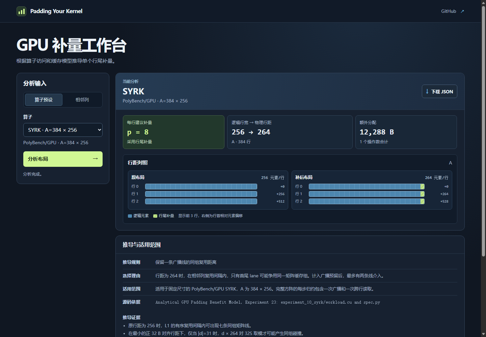

# Padding Your Kernel

用访存约束为 CUDA 算子直接推导一个行尾补量 (p)，并说明采用的规则、物理行距和额外分配。初版工作台包含 PolyBench/GPU 和 Rodinia 的 17 个算子预设，其中 MVT 提供两个尺寸。也可以输入满足模型条件的 FP32 相邻列复用布局。

[模型与适用范围](docs/theory.md) · [参与开发](CONTRIBUTING.md) · [版本记录](CHANGELOG.md)



## 快速开始

分析工具需要 Python 3.10 或更新版本，可在没有 NVIDIA GPU 的机器上运行。在仓库根目录安装并启动。

```text
python -m pip install .
padding-your-kernel serve
```

打开 [本地工作台](http://127.0.0.1:8766/) 。选择预设或输入参数，点击「分析布局」查看结果。报告可下载为 JSON。

```text
padding-your-kernel presets
padding-your-kernel preset syrk
padding-your-kernel adjacent-columns --rows 2048 --width 2048
```

两个示例分别给出 (p=8) 和 (p=16)。也可用 `python -m padding_your_kernel` 调用相同命令。工作台监听本机回环地址，可用 `serve --port 8770` 改端口。

## 如何读报告

| 字段 | 含义 |
|---|---|
| `p` | 每行增加的元素数。零表示紧凑布局。 |
| `layouts` | 各操作数的逻辑宽、物理行距与额外字节。 |
| `rule`、`reason` | 采用的访存约束及选择依据。 |
| `scope`、`assumptions` | 推导所覆盖的阶段、访问顺序和理想缓存条件。 |
| `status` | 建议填充、保留紧凑布局，或输入不在当前模型覆盖范围。 |

预设对应已声明的源码访问模式和固定尺寸。自定义分析需要显式声明行宽、行数、输入基址对齐及同组干扰预算。报告中的补量是模型推导结果。实际缺失数与加速比需在目标 GPU 上分别验证。

## 仓库结构

| 目录 | 内容 |
|---|---|
| `src/padding_your_kernel/` | 同一分析核心、CLI、本地 API 和 Web 工作台。 |
| `tests/` | 公式、预设和 HTTP 接口的无 GPU 检查。 |
| `docs/` | 公式推导和各预设的适用范围。 |

```text
python -m pip install -e .
python -B -m unittest discover -s tests -v
```
